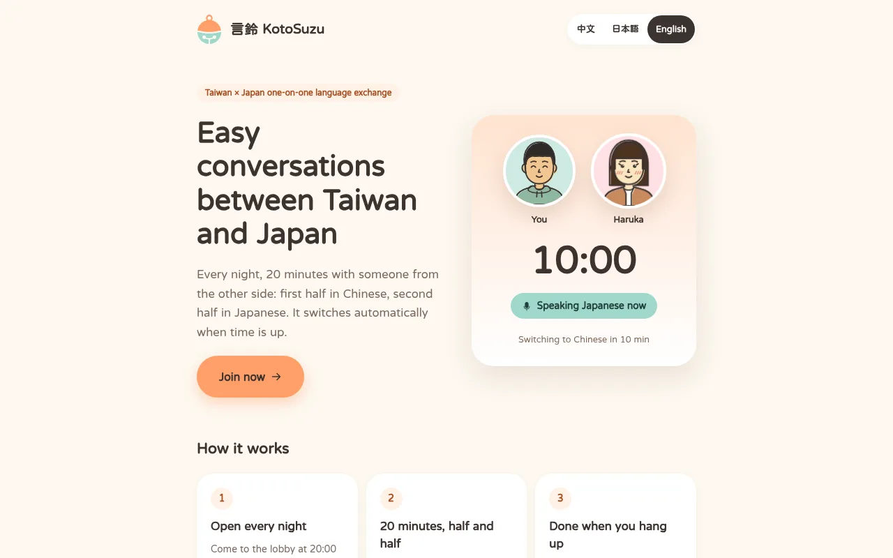
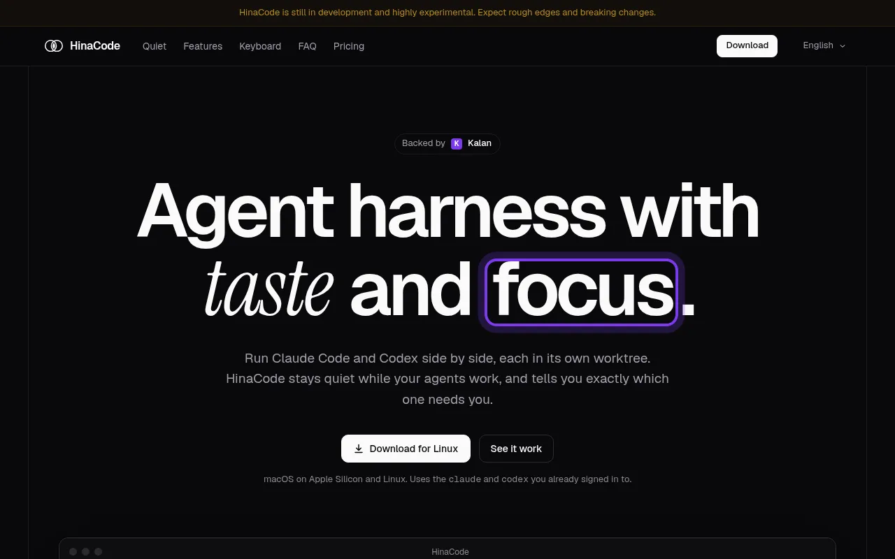
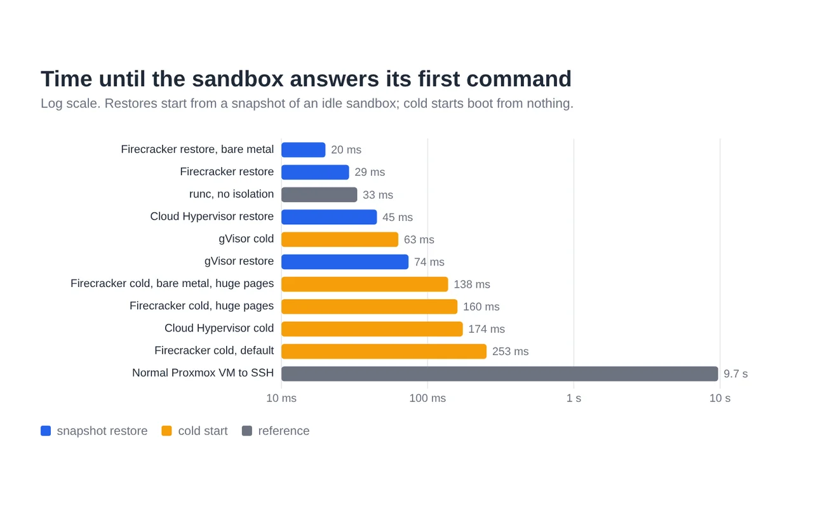
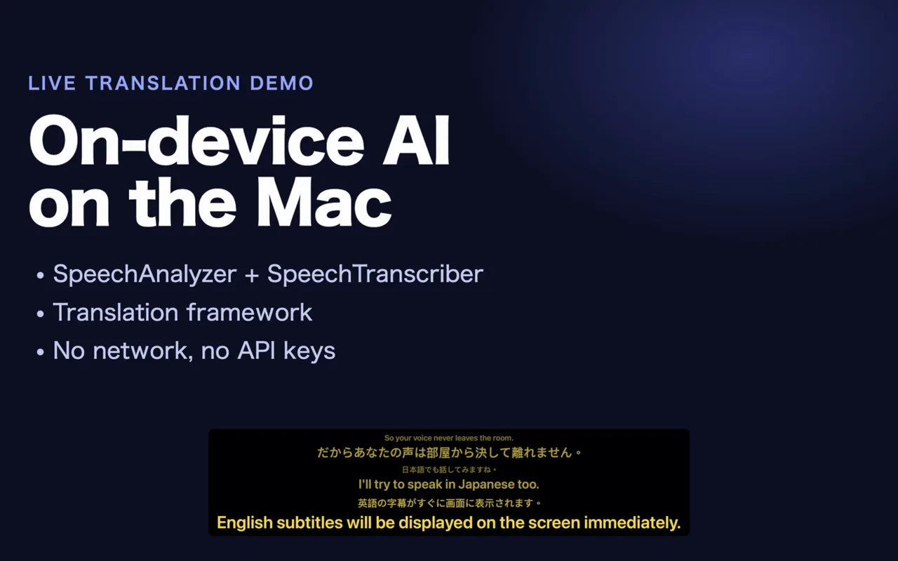
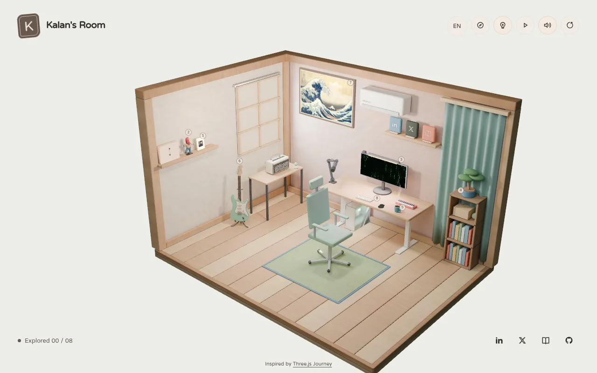

# Hi, I'm Kalan

I'm a software engineer from Taiwan, living in Fukuoka, Japan, and the founder of [hinadev](https://hinadev.com).

I spent 5.5 years as a frontend engineer and tech lead at LY Corporation (LINE Yahoo), then ran a five-person team as VP of Engineering at a manufacturing SaaS startup. Now I lead AI product work as a freelance tech lead and build my own products on the side.

[link.kalan.dev](https://link.kalan.dev) | [Blog](https://blog.kalan.dev) | [X](https://x.com/kalanyei)

## Now building

<table>
<tr>
<td width="50%" valign="top">

<h3><a href="https://suzuring.com">言鈴 KotoSuzu</a></h3>
Realtime voice language exchange between Taiwan and Japan. Every night you talk with one person from the other side for 20 minutes, half in Mandarin and half in Japanese. The app switches languages when time is up.
</td>
<td width="50%" valign="top">

<h3><a href="https://hinacode.app">HinaCode</a></h3>
A desktop app for running Claude Code and Codex side by side, each in its own git worktree. It stays quiet while the agents work and tells you which one needs you.
</td>
</tr>
<tr>
<td width="50%" valign="top">

<h3><a href="https://github.com/kjj6198/agent-sandbox">agent-sandbox</a></h3>
Tiny Firecracker microVMs for AI agents. Each sandbox restores from a snapshot of a booted VM and answers its first command in 29 ms. I benchmarked gVisor and Cloud Hypervisor before picking Firecracker.
</td>
<td width="50%" valign="top">

<h3><a href="https://github.com/kjj6198/live-translation">live-translation</a></h3>
Live English ⇄ Japanese subtitles on top of your slides. A macOS menu bar app built on Apple's on-device Speech and Translation frameworks, so it needs no API key and no audio leaves the Mac.
</td>
</tr>
</table>

## Side projects

- [Kalan's Room](https://room.kalan.dev) is my portfolio as a 3D room. Click the desk, guitar, or bookshelf for a story.
- [看見數字背後](https://vdata.assult.kalan.blog) visualizes Taiwan's sexual assault statistics from 2008 to 2025.
- [勞工大代誌](https://vdata.labor.kalan.blog) visualizes Taiwan's wages, working hours, and labor history from 2012 to 2025.
- [meeto-iot](https://github.com/kjj6198/meeto-iot) shows my next macOS Calendar event on an OLED screen over Bluetooth LE.
- [ts-arib-parse](https://github.com/kjj6198/ts-arib-parse) reads ARIB STD-B24, the subtitle format of Japanese TV, out of MPEG-TS streams.
- [pomodoro](https://github.com/kjj6198/pomodoro) is an Arduino pomodoro timer built on timer interrupts.

More

- [cloudflare-images-cli](https://github.com/kjj6198/cloudflare-images-cli) is `cfi`, a Rust CLI for Cloudflare Images. `brew install kjj6198/tap/cfi`
- [go-gui](https://github.com/kjj6198/go-gui) lets you play Go against KataGo, with live analysis and game review.
- [Podcast](https://github.com/kjj6198/Podcast) is the website for [八百屋 Boys](https://yaoyaboys.com), a Mandarin podcast about life and work in Japan.
- [refined-slack-hubot](https://github.com/kjj6198/refined-slack-hubot) is a Hubot-style Slack bot for GitHub releases, deployments, and review requests.

